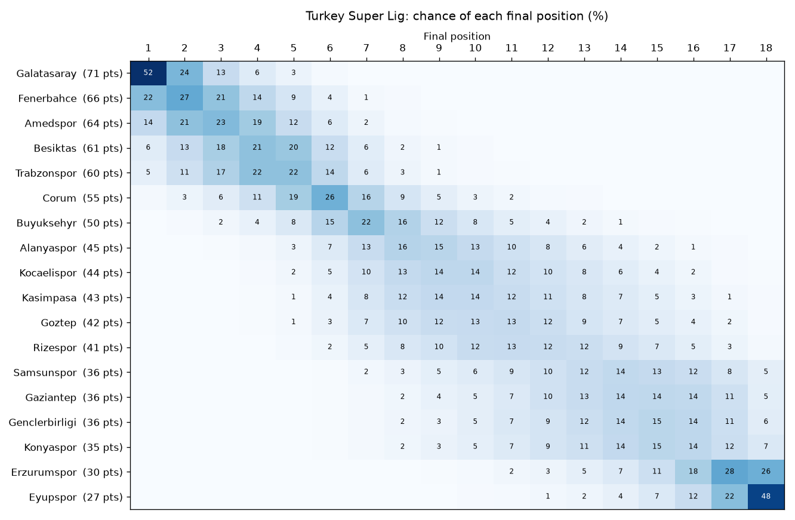

# football-predictor

[](https://github.com/akintaha2010-cloud/football-predictor/actions/workflows/tests.yml)

Estimates football match probabilities (home win / draw / away win, double chance, draw no bet, exact scores, over/under 1.5/2.5/3.5, Asian handicap, both teams to score) from past results.

## Setup

```
python -m venv .venv
source .venv/bin/activate
pip install -r requirements.txt
```

## Predict a match

```
python predict.py Galatasaray Fenerbahce
python predict.py Arsenal Chelsea --league E0
python predict.py Galatasaray Fenerbahce --neutral   # neutral venue, e.g. a cup final
python predict.py --league T1 --table      # team ratings
python predict.py --league T1 --table --csv ratings.csv   # ratings as a spreadsheet
python predict.py Galatasaray Fenerbahce --json   # JSON for other programs
python predict.py Galatasaray Fenerbahce --form   # plus each team's last 5 results
```

The first run downloads the last 3 seasons from [football-data.co.uk](https://www.football-data.co.uk) into `data/`. The current season is re-downloaded automatically when the local copy is more than 12 hours old (`--refresh` forces it); finished seasons are downloaded once. Leagues: `T1` Süper Lig, `E0` Premier League, `E1` Championship, `SP1` La Liga, `I1` Serie A, `D1` Bundesliga, `F1` Ligue 1, `N1` Eredivisie, `P1` Primeira Liga, `E2` League One, `SC0` Scottish Premiership, `SC1` Scottish Championship, `B1` Belgian Pro League, `G1` Greek Super League, `D2` 2. Bundesliga, `I2` Serie B, `SP2` Segunda División, `F2` Ligue 2.

```
Galatasaray vs Fenerbahce
  Expected goals:   2.14 - 1.57

  Galatasaray win:           50.0%
  Draw:                      22.6%
  Fenerbahce win:            27.4%

  Double chance 1X:          72.6%
  Double chance 12:          77.4%
  Double chance X2:          50.0%
  Draw no bet:               64.6% - 35.4%

  Over 1.5 goals:            89.3%
  Over 2.5 goals:            71.5%
  Over 3.5 goals:            50.7%
  Both teams score:          70.7%

  Asian handicap for Galatasaray:
    Line                       win   push   lose
    -1.0                     30.3%  19.7%  50.0%
    -0.5                     50.0%   0.0%  50.0%
    +0.0                     50.0%  22.6%  27.4%

  Most likely scores:
    1-1    9.2%
    2-1    8.8%
    2-2    6.9%
```

## Predict the next round

```
python fixtures.py --league T1
python fixtures.py --league E0 --csv predictions.csv
```

`fixtures.py` lists every upcoming match on football-data.co.uk's fixtures page with home/draw/away, over 2.5 and the most likely score.

## Simulate the season

```
python simulate.py --league T1
python simulate.py --league E0 --top 4 --relegated 3 --sims 20000
python simulate.py --league T1 --plot docs/season_T1.png
```



`simulate.py` plays every remaining fixture of the current season 10,000 times with the model's score probabilities. It then reports each team's expected points and its chances of winning the title, finishing in the top N, or being relegated. `--plot` saves the full table of position chances as a heatmap. Ties are broken on goal difference, then goals scored. Leagues that use head-to-head first are approximated.

## Compare with bookmaker odds

```
python value.py --league E0
python value.py --league T1 --min-edge 0.10
```

`value.py` downloads upcoming fixtures with market average odds from football-data.co.uk. For each outcome it prints the model probability, the fair odds (`1 / p`) and the edge (`p × odds − 1`). Outcomes above `--min-edge` are flagged together with the Kelly stake. The backtest below shows the model is slightly less accurate than closing odds, so treat flagged bets as disagreements to look into, not guaranteed profit.

## How it works

`football_predictor/model.py` implements the Dixon-Coles (1997) model. Each team has an attack and a defence rating, and goals are Poisson distributed:

- home goals: `λ = exp(home_adv + attack[home] − defence[away])`
- away goals: `μ = exp(attack[away] − defence[home])`

On top of that:
- A correction `ρ` adjusts the 0-0, 1-0, 0-1 and 1-1 probabilities, which plain Poisson gets wrong.
- Older matches count less: `weight = exp(−ξ · days_ago)`, with `ξ = 0.0019`, a half-life of about one year.
- An L2 penalty pulls ratings toward average, so newly promoted teams with only a few matches don't get extreme ratings.

The ratings are fitted by maximum likelihood (L-BFGS-B with an analytic gradient, about 0.01 s). The score matrix (0–10 goals each) then gives every market.

## Backtest

`backtest.py` refits the model before each week of a season and predicts that week's matches. The first 4 weeks are skipped. Results for the 2025/26 season:

| League | Matches | Model log loss | Bookmaker log loss | Model accuracy | Bookmaker accuracy | Always pick the most common result |
|---|---|---|---|---|---|---|
| Süper Lig (T1) | 276 | 1.000 | 0.977 | 50.7% | 54.3% | 42.4% |
| Premier League (E0) | 350 | 1.025 | 1.016 | 47.1% | 49.7% | 42.0% |
| La Liga (SP1) | 349 | 0.980 | 0.963 | 52.1% | 54.7% | 49.3% |

The model is clearly better than guessing the most common result. It is a little behind bookmaker closing odds, which also price in injuries, line-ups and news.

```
python backtest.py --league E0 --season 2526
```

It also prints a calibration table: all predicted probabilities are grouped into bins, and the average prediction in each bin is compared with how often those outcomes actually happened. A well-calibrated model has the two columns close together.

## Tests

```
python -m pytest
```

## Contributing

See [CONTRIBUTING.md](CONTRIBUTING.md).

## License

MIT, see [LICENSE](LICENSE). Match data comes from [football-data.co.uk](https://www.football-data.co.uk) and is subject to its own terms.
